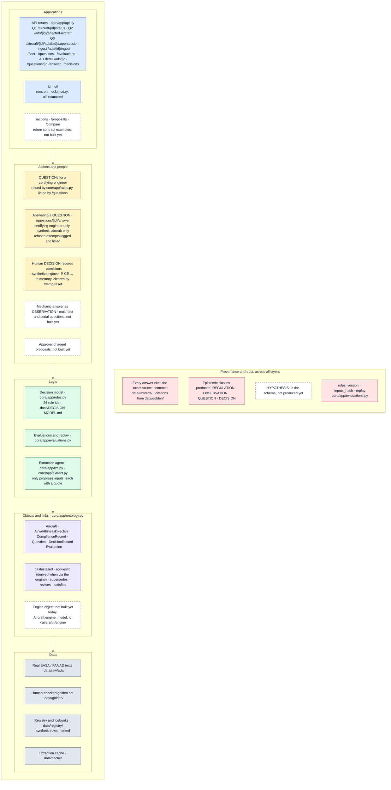
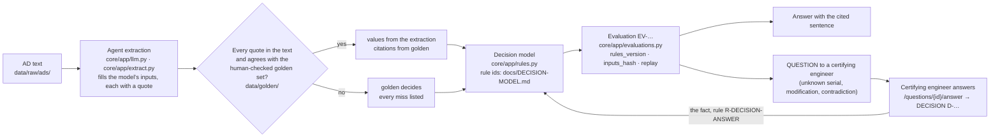

# AD Brain

AD Brain tells a maintenance organisation which airworthiness directives (ADs) apply to each aircraft, which
ones were superseded, and what is still unknown, citing the exact sentence of the AD for every claim.
**Decisions come from an explicit decision model, not a prompt; every decision is replayable and names the
rule that fired and the rules version that decided it.**

<!-- VIDEO -->

## Architecture

Every box names the file or folder that implements it; dashed boxes are not built yet.
`core/tests/test_readme_diagrams.py` fails if a path or route named in these diagrams does not exist.



## How it decides



The LLM only proposes inputs (applicability, conditions, supersession, credit), each with a verbatim quote.
Whether an AD applies, which AD is in force and the aircraft status are computed by `core/app/rules.py`:
26 rules, each with an id, listed as a decision table in [docs/DECISION-MODEL.md](docs/DECISION-MODEL.md).
A case the rules do not cover becomes a QUESTION, never a guess. A certifying engineer answers it with a DECISION;
the next evaluation uses that fact, and replay names the decision that changed the result. A synthetic engineer
can never decide about a real registered aircraft (403, logged).

## Quickstart (no API key needed)

Python 3.11+. `DEMO_MODE` defaults to `true`: the server reads the cached extraction in `data/cache/` and never
calls an LLM, so no `.env` and no key are needed.

Windows (PowerShell):
```powershell
git clone <this repo> ad-brain; cd ad-brain
py -3 -m venv .venv
.venv\Scripts\python -m pip install -r core/requirements.txt
.venv\Scripts\python -m uvicorn app.api:app --app-dir core --port 8000
```

macOS / Linux:
```bash
git clone <this repo> ad-brain && cd ad-brain
python3 -m venv .venv
.venv/bin/python -m pip install -r core/requirements.txt
.venv/bin/python -m uvicorn app.api:app --app-dir core --port 8000
```

Tests: `python -m pytest core` · end to end: `python scripts/smoke.py` (starts its own server; fails if port 8000
is taken). Verified from a fresh clone on Windows 11 with Python 3.11 on 14 Nov 2026 (the tests also pass on 3.14);
the macOS/Linux lines were not run on a Mac.

## The demo in 6 calls

Real output, excerpted, from a fresh clone on 14 Nov 2026 (urgency depends on the date). On Windows use `curl.exe`.

**1. DEMO-01 is green** (the AD of step 2 is not loaded yet)
```bash
curl http://127.0.0.1:8000/aircraft/DEMO-01/status
```
```json
{"status": "green", "evaluation_id": "EV-0001",
 "summary": "DEMO-01: all applicable ADs in the loaded set are complied with or not applicable."}
```

**2. Ingest FAA AD 2012-02-02** (the agent's extraction, from the cache)
```bash
curl -X POST http://127.0.0.1:8000/ads/FAA%3A2012-02-02/ingest
```
```json
{"source": "cache",
 "extraction": {"used": true, "agreement": 1.0,
                "reason": "values from the extraction; citations from golden (human-checked)"},
 "changes": {"superseded": ["FAA:2008-03-02"],
             "aircraft_status_changed": [{"aircraft_id": "DEMO-01", "from": "green", "to": "red"}]}}
```

**3. DEMO-01 is red, with the sentence and the rule**
```bash
curl http://127.0.0.1:8000/aircraft/DEMO-01/status
```
```json
{"status": "red", "evaluation_id": "EV-0002",
 "applies_because": "S/N 172S10600 is within 172S10490–172S11073 (Group 4)",
 "citation": {"quote": "Group 4: Model 172S, S/N 172S10490 through 172S11073",
              "file": "data/raw/ads/FAA-2012-02-02.txt", "origin": "golden"},
 "reasoning_step": {"from": "FAA:2012-02-02", "link": "appliesTo", "to": "DEMO-01", "rule_id": "R-SERIAL-RANGE"}}
```

**4. Replay the first decision**: same recorded inputs, current rules
```bash
curl -X POST http://127.0.0.1:8000/evaluations/EV-0001/replay
```
```json
{"same": false, "before": "green", "after": "red",
 "changed": {"rules_version": true, "rules_py": false, "ads_added": ["FAA:2012-02-02"],
             "ads_removed": [], "ads_changed": []}}
```

**5. Is DEMO-01's 2009 engine compliance still valid after supersession?** (Q3)
```bash
curl http://127.0.0.1:8000/aircraft/DEMO-01/ads/FAA%3A2006-20-09/supersession
```
```json
{"chain": ["FAA:2006-20-09 (superseded)", "FAA:2012-19-01 (active)"], "still_valid": "yes",
 "reason": "FAA:2012-19-01 has no compliance record of its own; record CR-DEMO01-ENG-1 (compliance with FAA:2006-20-09) is credited by paragraph (g)(1) of FAA:2012-19-01: \"(1) If you previously complied with AD 2006-20-09 (71 FR 57407, September 29, 2006), no further action is required.\""}
```

**6. What is still unknown, by urgency** (the deadline is the aircraft's ARC review)
```bash
curl http://127.0.0.1:8000/questions
```
```json
{"total": 9, "questions": [
  {"aircraft_id": "DEMO-04", "text": "Is MOD2008/233 or SB-826-CS embodied on DEMO-04?",
   "deadline": "2026-11-28", "urgency": "high"},
  {"aircraft_id": "DEMO-03", "text": "Is ECi cylinder assemblies P/N AEL65102 series 'Classic Cast', casting head markings EC 65099-REV-1, cylinder SN 1 through 9879 installed on DEMO-03?",
   "deadline": "2027-01-20", "urgency": "medium"}]}
```
`curl -X POST http://127.0.0.1:8000/demo/reset` restores the demo state.

## Results

- **Tests:** 318 passed (`python -m pytest core`, 14 Nov 2026), including a test that the decision table and the
  code list the same rule ids and that every rule fires in some scenario, and one that every path and route in the
  diagrams above exists.
- **Extraction agreement** (LLM vs the 8 hand-checked ADs): 5 of 8 ADs agree on every compared field; 81 of 100
  golden items matched plus 25 extra items (64.8%); 121 of 121 extracted quotes found in the AD text. Every miss
  is listed in [docs/EXTRACTION-REPORT.md](docs/EXTRACTION-REPORT.md). Where an extraction disagrees, golden decides.
- **Cost:** the 9 calls behind the cached extraction (105,788 tokens) were logged before the gateway's own cost
  was recorded: about $0.43 at Anthropic's list price for Claude Sonnet 5.5, an estimate. One measured re-run of
  FAA:2012-02-02 cost $0.0280 at the gateway, against ≈ $0.0276 estimated for the cached run; per AD in the report.
- **Decision model:** [docs/DECISION-MODEL.md](docs/DECISION-MODEL.md).

## Honesty

- **Data:** 21 real ADs (EASA texts, and FAA ADs as republished by EASA; sources in `data/raw/ads/SOURCES.csv`).
  8 of them were checked by hand against the text (`data/golden/`); only those 8 are used for decisions.
- **Aircraft:** `DEMO-01`…`DEMO-05` and their logbooks are **synthetic** (marked `synthetic: true`). The 3 real
  aircraft come from the Irish IAA register (September 2025 snapshot); **real aircraft are never shown as
  non-compliant**: their status is always `no_records`. No owner names or addresses are stored.
- **No interviews:** no maintenance organisation or certifying engineer was interviewed.
- **Human decisions in the demo:** a QUESTION can be answered only as a certifying engineer, only on a synthetic
  aircraft, by the synthetic engineer `P-CE-1`; decisions and the action log live in memory and are cleared by
  `/demo/reset`.
- **Not built yet:** a mechanic's answer as an OBSERVATION; answering questions about more than one fact (e.g.
  DEMO-04's "MOD2008/233 or SB-826-CS") or about an unclear serial; actions and approval of agent proposals
  (`/actions` and `/proposals` are placeholders that return contract examples or an empty list); `/compare`
  (contract example); LLM-written summaries (all summaries are templates); deadline arithmetic (a missing record counts as
  overdue, true for the 8 ADs); part numbers, AMOCs, repetitive inspections. The UI in `ui/` runs on mocks.
- **Prepared before the event:** [docs/PREPARED.md](docs/PREPARED.md).

## AI tools and team

- Claude Code (Claude Opus 5.5) and claude.ai: planning, research and code assistance.
- In the product: the extraction agent calls anthropic/claude-sonnet-5.5 through the KVA Vercel AI Gateway
  (once per AD, cached).
- Team: Niccolò Paparella (core: data, decision model, API) and Matteo Raimondi (UI, pitch, business case).
